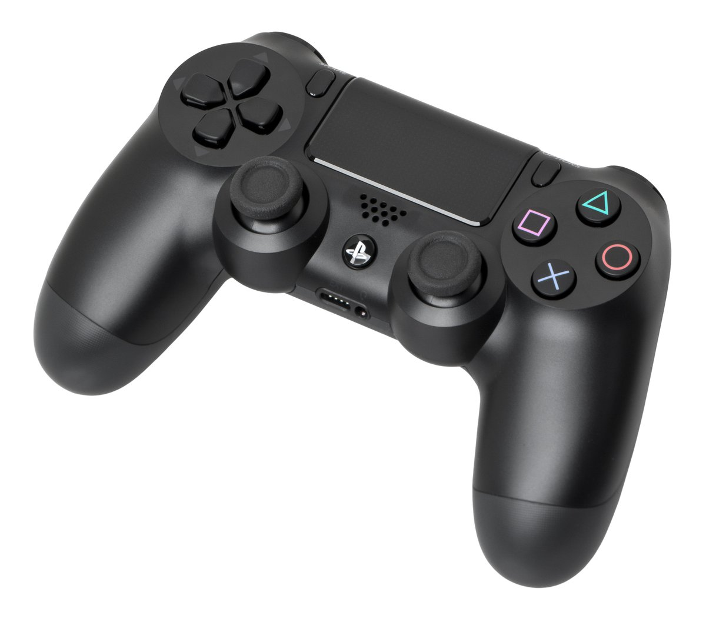

<p align="center">
  
  <br><sub>DualShock 4 &mdash; photo by Evan-Amos, public domain, via <a href="https://commons.wikimedia.org/wiki/File:DualShock_4.jpg">Wikimedia Commons</a></sub>
</p>

# mcu-gamecontroller

<p align="center">
  
  
  
</p>

A small C game controller library for **ESP-IDF 5.2+** and **STM32 HAL**.
The Sony DualShock 4 and DualSense, and the Xbox Wireless Controller, arrive
over Bluetooth through ESP-IDF's HID host and hand out one
`struct gamecontroller_dev`: two sticks, two analog triggers, buttons named
by position, the battery, and rumble, light bar and player LEDs where the
pad has them. This library replaces `esp-ps-controller`, whose
`ps_controller_*` calls it keeps; the Xbox pad and the STM32 side are new.

The repository is named `mcu-gamecontroller`; the C API,
`CONFIG_GAMECONTROLLER_*` options and forge package key are
`gamecontroller`. The clone command below names the ESP-IDF component
directory `gamecontroller` as well.

> **Hardware unverified.** Host tests use layout-derived reports and fakes
> of the Bluetooth stack. Nothing here has run with a pad -- and the **Xbox
> pad is written from documents alone**.

[Supported hardware](#supported-hardware) · [Drivers](#drivers) ·
[Install](#install) ·
[Quick start](#quick-start) · [Examples](#examples) ·
[Documentation](#documentation) · [Tests](#tests)

## Supported hardware

| Pad | Transport | Notes |
|---|---|---|
| **DualShock 4** (PS4) | Bluetooth Classic HID | Sony PS4 pad |
| **DualSense** (PS5) | Bluetooth Classic HID | Sony PS5 pad |
| **Xbox Wireless Controller**, BLE firmware (models 1708, 1797, 1914) -- **unverified** | Bluetooth LE HID | Microsoft pad |

Bluetooth Classic exists on the ESP32 alone (`SOC_BT_CLASSIC_SUPPORTED`),
so the PlayStation pads need a plain ESP32; the ESP32-S3 boards of this
workspace can take only the Xbox pad. **The STM32 HAL has no Bluetooth
transport here**: it builds the core and the pads' report parsers and
output builders, for an app that brings the reports some other way.

## Drivers

<details><summary><b>DualShock 4</b> (PS4) — Bluetooth Classic HID</summary>

- Chips: ESP32 only
- Outputs: rumble, light bar
- Example: [ps_controller](examples/esp/ps_controller/) (ESP32):
  esp-ps-controller's own example, unchanged, now with its Bluetooth settings
- Example: [gamecontroller](examples/esp/gamecontroller/) (ESP32): any pad;
  rumble and light bar from buttons
- Example: [parsers](examples/stm/parsers/main.c) (STM32): the report parser
  and builder, fed by the app's own transport
- Chip reference: [DualShock 4](docs/chips.md#dualshock-4)

</details>

<details><summary><b>DualSense</b> (PS5) — Bluetooth Classic HID</summary>

- Chips: ESP32 only
- Outputs: rumble, light bar, player LEDs
- Example: [ps_controller](examples/esp/ps_controller/) (ESP32):
  esp-ps-controller's own example, unchanged, now with its Bluetooth settings
- Example: [gamecontroller](examples/esp/gamecontroller/) (ESP32): any pad;
  rumble and light bar from buttons
- **Rumble is the classic kind** on the DualSense, the same on every
  firmware; see [the chip reference](docs/chips.md#rumble).
- Chip reference: [DualSense](docs/chips.md#dualsense)

</details>

<details><summary><b>Xbox Wireless Controller</b> — Bluetooth LE HID</summary>

BLE firmware (models 1708, 1797, 1914) -- **unverified**.

- Chips: any ESP with BLE: ESP32, S3, C3, C6, ...
- Outputs: rumble
- Example: [gamecontroller](examples/esp/gamecontroller/) (ESP32): any pad;
  rumble and light bar from buttons
- Example: [xbox](examples/esp/xbox/) (ESP32-S3): an Xbox pad over BLE
  (unverified)
- Chip reference: [Xbox Wireless Controller
  (unverified)](docs/chips.md#xbox-wireless-controller-unverified)

</details>

## Install

### ESP-IDF

Clone into your project's components directory:

```sh
git clone https://github.com/JonasAtelier/mcu-gamecontroller components/gamecontroller
```

Enable the pads in `idf.py menuconfig` → **Component config → Game
controller subsystem**, and Bluetooth for them; for a DualShock 4 on an
ESP32, in `sdkconfig.defaults`:

```ini
CONFIG_BT_ENABLED=y
CONFIG_BTDM_CTRL_MODE_BR_EDR_ONLY=y
CONFIG_BT_BLUEDROID_ENABLED=y
CONFIG_BT_CLASSIC_ENABLED=y
CONFIG_BT_HID_ENABLED=y
CONFIG_BT_HID_HOST_ENABLED=y
CONFIG_GAMECONTROLLER_DS4=y
```

Each example in `examples/esp/` carries a working set. Components declare
`REQUIRES gamecontroller` in `idf_component_register()`.

### esp-forge / stm-forge

Add to `profiles/pkgversion`:

```make
gamecontroller_GIT=https://github.com/JonasAtelier/mcu-gamecontroller@stable
```

Enable the package and the pads in `configs/<target>_defconfig`, and on
esp-forge Bluetooth in the target's sdkconfig:

```make
PKG_gamecontroller     = y
GAMECONTROLLER_XBOX    = y
```

stm-forge must be at `ee921c3` or later, which builds the pad folders in
`src/`.

**No pad is enabled by default.** See the
[installation guide](docs/installation.md) for all options.

## Quick start

On an ESP32, any pad:

```c
#include "gamecontroller_bt.h"

ESP_ERROR_CHECK(nvs_flash_init());        /* Bluedroid keeps keys in NVS */
gamecontroller_bt_config_t cfg = {
    .scan_seconds = 30, .playstation = true, .xbox = true,
};
ESP_ERROR_CHECK(gamecontroller_bt_start(&cfg));   /* blocks until a pad */

struct gamecontroller_dev *pad = gamecontroller_bt_pad(0);
struct gamecontroller_state s;
gamecontroller_get_state(pad, &s);
if (gamecontroller_pressed(&s, GAMECONTROLLER_BTN_SOUTH))   /* Cross, A */
    gamecontroller_set_rumble(pad, 200, 100);
```

- Sticks are -32768..32767, +x right, +y down; triggers 0..65535; battery
  0..100 % or unknown. See [API usage](docs/usage.md).
- esp-ps-controller code keeps working: `ps_controller_start()`,
  `ps_controller_get()` and the rest, unchanged; `ps_controller_dev()` hands
  out the same pad as a `struct gamecontroller_dev`.
- On ESP-IDF the Bluetooth calls return `esp_err_t`; `gamecontroller_*`
  returns **0 or a negative errno** on both platforms.

## Examples

Each driver's examples are listed under [Drivers](#drivers).

ESP-IDF examples locate this library through `EXTRA_COMPONENT_DIRS`, which
assumes the repository is checked out as `gamecontroller`. With ESP-IDF
activated:

```sh
cd examples/esp/gamecontroller
idf.py build
```

## Scope and limitations

- **One report at a time**: no touchpad points, motion sensors, audio,
  adaptive triggers or paddles.
- **Up to four pads** at once (`CONFIG_GAMECONTROLLER_MAX_PADS`, default 1).
- **Bluetooth is RAM-hungry**: Bluedroid with Classic, BLE and the HID host
  on one ESP32 costs tens of kilobytes.

## Documentation

| Guide | Contents |
|---|---|
| [Installation](docs/installation.md) | Forge, ESP-IDF, STM32 HAL, the Bluetooth options per chip |
| [Hardware](docs/hardware.md) | Which chip for which pad, pairing, the bus layer |
| [API usage](docs/usage.md) | The pad and its state, outputs, the Bluetooth calls, threads, errors, changes from esp-ps-controller |
| [Chip reference](docs/chips.md) | Report layouts and their sources, the DualSense output conflict, rumble, battery, the Xbox reports |
| [Development](docs/development.md) | Layout, platform ports, adding a pad, tests and vectors |

## Tests

```sh
make -C test test
```

Host-only; no toolchain, Bluetooth stack or pad needed. The report vectors
are derived from the documented layouts, not captured from pads. See the
[test reference](docs/development.md#tests).

## License

[MIT](LICENSE)
